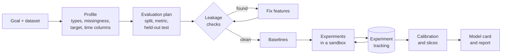

# ml-research-agent

An open-source AI agent that runs a machine learning project end to end. Give it a dataset
and a goal ("predict which orders will arrive late, optimise for recall at 10% of orders")
and it profiles the data, sets up a leak-free evaluation, trains a baseline and stronger
models, tracks every experiment, checks calibration and fairness slices, and writes a
model card that reports what it found, including what did not work.

> **Status:** design stage. The design doc and roadmap are written; the experiment runner,
> the sandbox and the leakage checks are being built now. No results are shown here until
> the benchmark has produced them.

## Why

Automated machine learning tools are good at searching models and bad at the parts that
make a model trustworthy: a split that matches how the model will be used, features that
do not leak the label, a baseline to beat, calibrated probabilities, and an honest write-up.
Agents that write code make that worse when nothing checks them, because a leaked feature
produces an impressive and useless score. This project puts those checks at the centre:

- **Evaluation first.** The agent chooses and justifies the split (random, grouped or by
  time) before any model is trained, and holds out a test set it touches once.
- **Leakage checks.** Features computed after the prediction time, near-perfect single
  features and train and test overlap are detected and reported before results are trusted.
- **Baselines before models.** Every run starts with simple baselines; a model is only
  reported against them.
- **Calibration and slices.** Probability calibration, and errors by meaningful segments.
- **Sandboxed code.** Generated training code runs without network access, within time and
  memory limits, inside its own run directory.
- **Reproducible.** Every experiment is tracked with its code, parameters, data hash, seed
  and metrics, and can be rerun.

## How it works



## Planned interface

```bash
pip install ml-research-agent        # not published yet
mlagent run data/orders.parquet --target late --goal "recall at 10% of orders" --model <provider:model>
mlagent report runs/<run-id>         # the model card and experiment table
mlagent bench --suite tabular-v1     # score the agent on benchmark tasks
```

## Benchmark

Tasks are public tabular datasets with a fixed evaluation and a known leakage trap where
one is realistic (for example a column that is only filled in after the outcome). The agent
is scored on held-out performance against the best simple baseline, on whether it caught
the trap, and on cost and time. A task set built on the Olist data in
[ecommerce-data-ai-platform](https://github.com/mohammadazam7/ecommerce-data-ai-platform)
gives one realistic, time-ordered problem with late deliveries.

## Documentation

- [Design doc](docs/design.md): goals, non-goals, design, alternatives, safety, testing plan
- [Roadmap](docs/ROADMAP.md): milestones and dates

## Development

```bash
python -m venv .venv && source .venv/bin/activate
make install
make check
```

See [CONTRIBUTING.md](CONTRIBUTING.md) and [SECURITY.md](SECURITY.md).

## License

MIT
