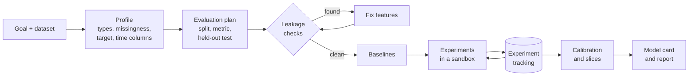

# ml-research-agent

An open-source AI agent that runs a machine learning project end to end. Give it a dataset
and a goal ("predict which orders will arrive late, optimise for recall at 10% of orders")
and it profiles the data, sets up a leak-free evaluation, trains a baseline and stronger
models, tracks every experiment, checks calibration and fairness slices, and writes a
model card that reports what it found, including what did not work.

> **Status:** milestone 2. The deterministic core (profiling, evaluation plan, leakage
> checks, baselines, runner, reports) and the agent loop on top of it are built and
> tested; the benchmark comes next. No model results are shown here until the benchmark
> has produced them.

## Why

Automated machine learning tools are good at searching models and bad at the parts that
make a model trustworthy: a split that matches how the model will be used, features that
do not leak the label, a baseline to beat, calibrated probabilities, and an honest write-up.
Agents that write code make that worse when nothing checks them, because a leaked feature
produces an impressive and useless score. This project puts those checks at the centre:

- **Evaluation first.** The agent chooses and justifies the split (random, grouped or by
  time) before any model is trained, and holds out a test set it touches once.
- **Leakage checks.** Features computed after the prediction time, near-perfect single
  features and train and test overlap are detected and reported before results are trusted.
- **Baselines before models.** Every run starts with simple baselines; a model is only
  reported against them.
- **Calibration and slices.** Probability calibration, and errors by meaningful segments.
- **Contained code.** Generated training code runs in its own process and directory,
  within time and memory limits. That is containment against mistakes, not a security
  boundary; untrusted code needs a container around it.
- **Reproducible.** Every experiment is tracked with its code, parameters, data hash, seed
  and metrics, and can be rerun.

## How it works



## Using it

```bash
pip install git+https://github.com/mohammadazam7/ml-research-agent
export MLAGENT_BASE_URL=http://localhost:11434/v1   # any OpenAI-compatible endpoint
export MLAGENT_MODEL=<model name>
export MLAGENT_API_KEY=<key>                        # not needed for a local server
mlagent run homes.csv --target price --experiments 5
```

```text
mlagent: 600 rows, target price
split: random; metric: mae (lower is better)
reason: regression target: mean absolute error, in the target's own units
reason: no time or entity column found: a seeded random split
baselines: prior 196981.4833, linear 63431.3275
attempt 1: failed               -      0.1 s
attempt 2: scored     196981.4833      0.2 s
attempt 3: scored      55038.9081      0.1 s
best: attempt 3, mae 55038.9081, beats the baselines
stopped: the model had nothing better to try
tokens: 0 in, 0 out
files: run
```

That output is from the test suite's scripted stand-in for a model (three fixed replies:
a script that crashes, one that predicts the median, one that fits a quadratic) on
made-up data. It shows what the loop does, not what any language model achieves; real
models are measured in the benchmark milestone. Exit status is 0 when the best attempt
beats both baselines, 1 when it does not and 2 when the run could not start.

### Who decides what

The model writes experiment scripts. It does not decide what counts:

- The split, the metric and the baselines come from the core before the model is asked
  anything.
- A script gets one file in which the target is empty for every test row. It writes one
  prediction per test row, and the judge computes the metric against the answers it
  kept. A score the script reports about itself is ignored.
- Columns the leakage checks flagged are withheld from that file, and from the
  baselines too, so the bar stays honest. The assignment says which and why, and
  `--keep COLUMN` overrides the check for a feature you know is legitimate.
- Every script, its predictions and a log line with the judge's score are kept in the
  run directory.

Still planned: `mlagent report` (model card and experiment table) and `mlagent bench`.

## Benchmark

Tasks are public tabular datasets with a fixed evaluation and a known leakage trap where
one is realistic (for example a column that is only filled in after the outcome). The agent
is scored on held-out performance against the best simple baseline, on whether it caught
the trap, and on cost and time. A task set built on the Olist data in
[ecommerce-data-ai-platform](https://github.com/mohammadazam7/ecommerce-data-ai-platform)
gives one realistic, time-ordered problem with late deliveries.

## Documentation

- [Design doc](docs/design.md): goals, non-goals, design, alternatives, safety, testing plan
- [Roadmap](docs/ROADMAP.md): milestones and dates

## Development

```bash
python -m venv .venv && source .venv/bin/activate
make install
make check
```

See [CONTRIBUTING.md](CONTRIBUTING.md) and [SECURITY.md](SECURITY.md).

## License

MIT
